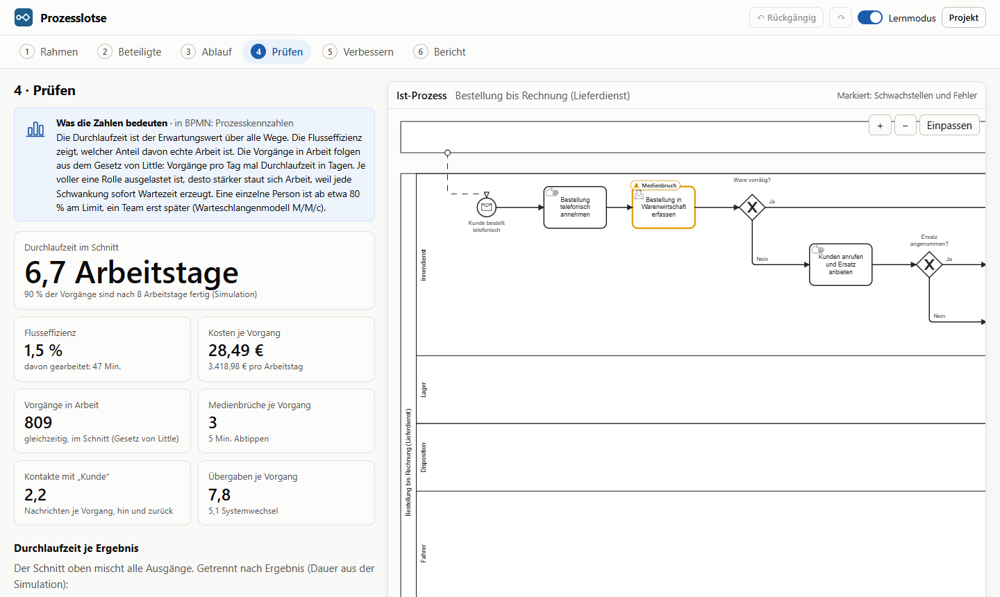
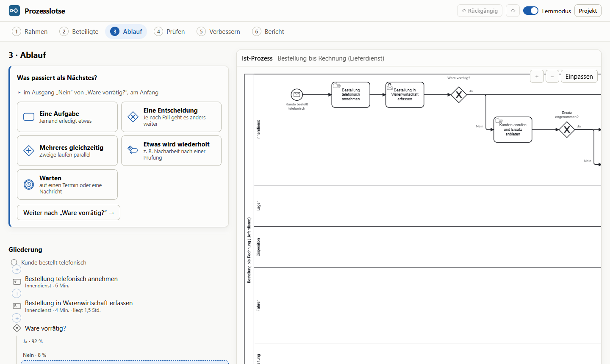
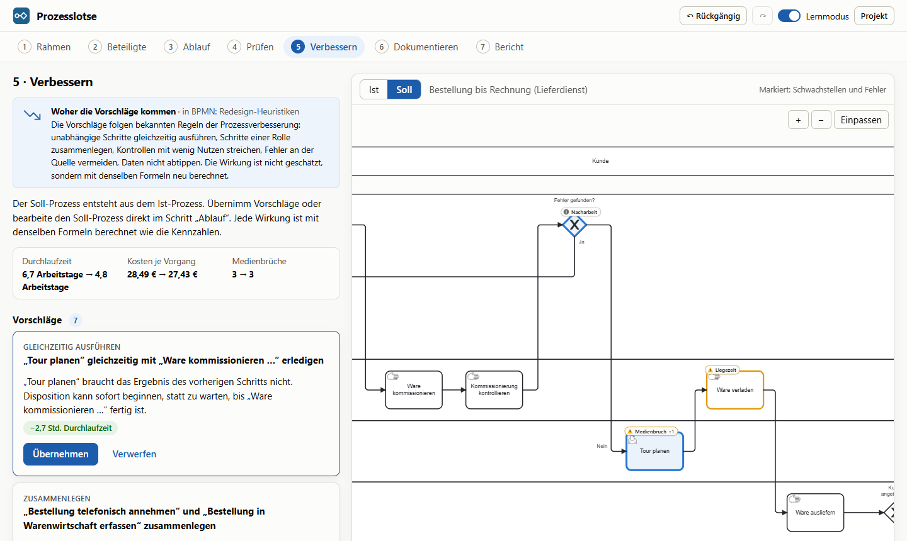

# Prozesslotse

Geschäftsprozesse über geführte Fragen modellieren, als BPMN-2.0-Diagramm zeichnen, mit Kennzahlen prüfen und mit begründeten Vorschlägen verbessern. Läuft als Windows-Programm oder im Browser, ohne KI und ohne Server.



## Was es kann

- **Geführter Assistent statt Zeichenwerkzeug.** Der Ablauf entsteht aus Antworten auf „Was passiert als Nächstes?“ und sechs Bausteinen: Aufgabe, Entscheidung, Mehrere Wege (ODER), Gleichzeitig, Wiederholung, Warten. Der Assistent führt nacheinander durch jeden Zweig einer Verzweigung.
- **Rückfragen und Korrekturschleifen.** Jeder Ausgang einer Entscheidung führt weiter, beendet den Prozess oder springt zu einem früheren Schritt zurück. Eine Entscheidung kann auch davon abhängen, was zuerst passiert (Antwort des Kunden, Stornierung, Ablauf einer Frist), in BPMN ein ereignisbasiertes Gateway.
- **Korrekt durch Bauweise und Prüfung.** Jede Verzweigung wird automatisch wieder zusammengeführt, Rücksprünge werden zu sauberen Bereichen (blockstrukturiertes Modell). Was die Bauweise allein nicht verhindert, etwa ein Prozessende innerhalb von „Gleichzeitig“ oder eine Entscheidung, deren Ausgänge alle zurückspringen, melden die Prüfregeln als Fehler. Dazu kommen Anteile ungleich 100 %, fehlende Angaben und Benennungen gegen die 7PMG-Richtlinien. Ein Tokenspiel nach den Ausführungsregeln von BPMN bestätigt in den Tests: Meldet die Prüfung keinen Fehler, ist das exportierte Diagramm sound.
- **Normgerechtes BPMN 2.0** mit einer Bahn je Rolle, Benutzer- und manuellen Aufgaben, Ereignissen und Diagramm-Informationen (DI). Externe Beteiligte wie der Kunde werden eigene Pools mit Nachrichtenflüssen (Kollaboration). Die Datei öffnet sich in bpmn.io, Camunda Modeler oder Signavio.
- **Saubere Linienführung:** Jeder Fluss ist eine eigene Linie; zwei Flüsse teilen sich nie eine Strecke oder einen Anschlusspunkt. Gateways verteilen ihre Wege auf eigene Anschlüsse, Spaltenlücken werden zu Kanälen mit einer Spur je Linie, die Reihenfolge minimiert Kreuzungen. Beschriftungen suchen sich einen freien Platz.
- **Kennzahlen mit nachvollziehbaren Formeln:** Durchlaufzeit, Flusseffizienz, Kosten je Vorgang, Auslastung je Rolle mit Engpass nach dem Warteschlangenmodell M/M/c (die Schwelle hängt von der Teamgröße ab), Vorgänge in Arbeit nach dem Gesetz von Little, Medienbrüche und Übergaben. Eine Monte-Carlo-Simulation liefert zusätzlich den 90-%-Wert der Durchlaufzeit und die Durchlaufzeit je Ergebnis (z. B. versendet, storniert, verfallen).
- **Schwachstellen im Diagramm:** Medienbruch, Engpass, lange Liegezeit, Nacharbeit, Freigabe ohne erkennbaren Nutzen, Kontrolle ohne Folge, dieselbe Person in parallelen Zweigen und Hin und Her zwischen Rollen werden am betroffenen Element markiert. Wiederholungen tragen einen Zweck: Nur Korrekturen zählen als Nacharbeit, gewollte Durchgänge („je Position“) nicht.
- **Vorschläge mit berechneter Wirkung.** Sechs Regeln formen eine Kopie des Prozesses um, die Wirkung kommt aus denselben Formeln wie die Kennzahlen. Übernommene Vorschläge ergeben den Soll-Prozess.
- **Bericht** mit Ist-Soll-Vergleich, Maßnahmen, Befunden und beiden Diagrammen. Export als BPMN, SVG und Projektdatei, Druck als PDF.
- **Windows-Programm (Tauri 2):** Installer mit 1,3 MB, pro Benutzer und ohne Admin-Rechte. Projekte sind `.prozesslotse`-Dateien; ein Doppelklick öffnet sie, auch im schon laufenden Programm. Speichern, Speichern unter, „Zuletzt geöffnet“, Rückfrage bei ungespeicherten Änderungen und PDF in A4 ohne Druckdialog. Exportiertes BPMN enthält das ganze Projekt und öffnet sich wieder verlustfrei; fremde BPMN-Dateien werden angezeigt.
- **Lernmodus:** Zu jeder Auswahl erklärt ein Hinweis das passende BPMN-Element.

| Ablauf beschreiben | Verbessern |
| --- | --- |
|  |  |

## Fallbeispiel

Ein regionaler Lieferdienst, von der telefonischen Bestellung bis zur Rechnung, mit 120 Vorgängen am Tag und 6 Rollen. Das Werkzeug findet:

- 6,7 Arbeitstage Durchlaufzeit, davon nur 1,5 % Bearbeitung
- einen Engpass bei der Niederlassungsleitung (98 % Auslastung) durch eine Freigabe, die in 98 % der Fälle erteilt wird, und einen bei der Buchhaltung (81 %, eine Person)
- drei Medienbrüche, Nacharbeit beim Kommissionieren, zweimal Hin und Her zwischen Rollen

Zwei Vorschläge (Freigabe streichen, Tourenplanung parallel zur Kommissionierung) senken die Durchlaufzeit auf 4,5 Arbeitstage.

Ein zweites Beispiel, **Onlinebestellung**, zeigt eine Korrekturschleife: Sind die Bestelldaten fehlerhaft, wird der Kunde gefragt. Kommt seine Korrektur, geht es zurück zur Erfassung; storniert er oder läuft die Frist von 7 Tagen ab, endet der Vorgang.

## Formeln

| Kennzahl | Berechnung |
| --- | --- |
| Häufigkeit eines Schritts | Produkt der Anteile auf dem Weg dorthin; eine Wiederholung, die in r der Durchläufe wiederholt, läuft 1 / (1 − r)-mal |
| Durchlaufzeit | hintereinander addiert, Entscheidung gewichtet gemittelt, Gleichzeitig: Erwartungswert des Maximums der Zweigdauern (aus deren Verteilungen), Wiederholung: Körper × 1 / (1 − r) |
| Flusseffizienz | theoretische Durchlaufzeit (gleiche Rechnung, nur Bearbeitungszeiten) / Durchlaufzeit |
| Kosten je Vorgang | Σ Häufigkeit × Bearbeitungszeit × Stundensatz der Rolle |
| Auslastung | Vorgänge pro Tag × Arbeitszeit der Rolle je Vorgang / (Personen × Arbeitsstunden × verfügbarer Anteil) |
| Engpass | mittlere Wartezeit nach M/M/c (Erlang C) mindestens viermal so lang wie die Bearbeitung: bei einer Person ab 80 % Auslastung, bei zwei ab 89 %, bei sechs ab etwa 95 % |
| Vorgänge in Arbeit | Vorgänge pro Tag × Durchlaufzeit in Arbeitstagen (Gesetz von Little); bei Überlast nicht angegeben, weil der Bestand dann wächst |
| Medienbrüche, Übergaben | erwartete Anzahl manueller Übertragungen bzw. Rollenwechsel zwischen aufeinanderfolgenden Aufgaben |

Wiederholungen werden geschlossen gelöst, nicht ausgerollt. Ein Ausgang, der den Prozess vorzeitig beendet, geht mit seiner Wahrscheinlichkeit in alle Werte ein.

## Verbesserungsregeln

| Regel | Erkennt | Umformung |
| --- | --- | --- |
| Gleichzeitig ausführen | Schritt braucht das Ergebnis des vorherigen nicht, andere Rolle | beide Schritte in „Gleichzeitig“ |
| Medienbruch beseitigen | Daten werden von Hand übertragen | Übertragung und ihre Minuten entfallen |
| Zusammenlegen | zwei Schritte derselben Rolle mit Liegezeit dazwischen | ein Schritt, Liegezeit und Abtippen entfallen |
| Nacharbeit senken | Korrektur-Wiederholung in mindestens 15 % der Durchläufe | Anteil halbiert (als Annahme gekennzeichnet) |
| Kontrolle reduzieren | Freigabe wird in mindestens 90 % der Fälle erteilt | Freigabe entfällt, eine direkt folgende Entscheidung darüber mit (als Annahme gekennzeichnet) |
| Knock-out-Reihenfolge | mehrere Prüfungen hintereinander, die jeweils Fälle aussortieren | aufsteigend nach Dauer / Ausfallquote sortiert, so dass die schnelle, oft aussortierende Prüfung zuerst kommt (Unabhängigkeit als Annahme) |

Prüfungen und Freigaben werden nie mit anderen Schritten zusammengelegt (Vier-Augen-Prinzip).

## Aufbau

| Ordner | Inhalt |
| --- | --- |
| `src/modell` | Datenmodell, Operationen, Prüfregeln, Führung durch den Ablauf, Speichern, Fallbeispiel |
| `src/analyse` | Kennzahlen, Simulation, Schwachstellen, Verbesserungsregeln |
| `src/bpmn` | eigenes Layout mit Bahnen und Spuren, Linienführung mit Kanälen, BPMN-XML mit DI, Tokenspiel |
| `src/ui` | React-Oberfläche: Assistent, Diagramm (bpmn-js), Prüfen, Verbessern, Bericht |
| `src/plattform` | Öffnen, Speichern und Fenster: im Browser per Download, im Programm über den Rust-Teil |
| `src-tauri` | Windows-Programm: Dateibefehle nur für vom Benutzer gewählte Pfade, Menü, PDF über WebView2, Installer |
| `e2e` | Browsertests mit Playwright und axe |
| `docs` | [Datenmodell](docs/datenmodell.md) mit Zeichenregeln, [Fragenkatalog](docs/fragenkatalog.md), [Modellierung, Format 3](docs/modellierung-v3.md), [Modellierung, Format 4](docs/modellierung-v4.md) mit [Stand](docs/modellierung-stand.md), [Compliance-Doku](docs/compliance-spezifikation.md) |

Die Fachlogik kennt kein React und ist vollständig getestet. bpmn-js dient nur der Anzeige; Layout und BPMN-Export sind selbst geschrieben.

**Technik:** React 19, TypeScript 7, Vite 8, bpmn-js 18, Tauri 2 (Rust), Vitest, Playwright, GitHub Actions.

## Qualität

- 127 Unit-Tests und 3 Rust-Tests, darunter von Hand nachgerechnete Kennzahlen und ein Belastungstest mit 300 zufällig erzeugten, verschachtelten Prozessen (mit Rücksprüngen, Ereignis-Entscheidungen, ODER-Verzweigungen und Nachrichten): keine Überlappung, keine Kante durch fremde Elemente, keine zwei Linien auf derselben Strecke oder am selben Anschluss, Beschriftungen frei, Schema-Prüfung mit bpmn-moddle.
- Tokenspiel nach den Ausführungsregeln von BPMN 2.0: Für beide Beispiele und alle 300 Zufallsprozesse ist das exportierte Diagramm sound (keine Verklemmung, jeder Vorgang kann enden, kein toter Schritt), und die Häufigkeiten aus dem Tokenspiel stimmen mit den Formeln überein.
- 17 Browsertests: Prozess vollständig über den Assistenten anlegen, Korrekturschleife mit Rücksprung, ODER-Verzweigung, Kunde als Pool mit Nachrichten, Tastaturbedienung, Vorschlag übernehmen, Exporte, Datei öffnen, BPMN wieder öffnen, Rückfrage bei ungespeicherten Änderungen.
- Desktop-Test am echten Programm (`npm run desktop:test`): 16 Prüfungen von Speichern unter bis zur Rückfrage beim Schließen, PDF-Seite in A4.
- Installer-Test in der CI auf Windows: still installieren, Dateizuordnungen prüfen (`.bpmn` nur unter „Öffnen mit“), still deinstallieren.
- Barrierefreiheit: axe meldet in keinem Schritt schwere Befunde, weder hell noch dunkel; jedes Eingabefeld ist beschriftet.
- Bei jedem Push laufen Lint, Unit-Tests, Build und Browsertests.

## Entwickeln

```bash
npm install
npm run dev       # Entwicklungsserver
npm test          # Unit-Tests (Vitest)
npm run e2e       # Browsertests (lokal mit Edge, in der CI mit Chrome)
npm run build     # Typprüfung und Produktions-Build

# Windows-Programm (braucht Rust und die VS Build Tools)
npm run desktop                        # Programm mit Entwicklungsserver
npm run desktop:build                  # Programm und Installer (src-tauri/target/release/bundle/nsis)
npx tauri build --debug --no-bundle    # Debug-Build für den Desktop-Test
npm run desktop:test                   # Desktop-Test gegen den Debug-Build
```

`node scripts/readme-bilder.mjs` erzeugt die Bilder dieser README neu (bei laufendem `npx vite preview --port 4173`).

## Grenzen

- Zeiten und Anteile sind Schätzungen; alle Werte sind Erwartungswerte.
- Die Simulation würfelt die Wege (Entscheidungen, Wiederholungen), nicht die Zeiten je Schritt. Der 90-%-Wert ist deshalb eher zu niedrig.
- Wartezeiten durch Auslastung gehen nicht in die Durchlaufzeit ein; dafür stehen die geschätzten Liegezeiten. Das Warteschlangenmodell bewertet nur, ab wann eine Rolle zum Engpass wird. Es nimmt zufällig eintreffende Arbeit an und ist für geplante, gebündelte Arbeit eher zu vorsichtig.
- Bei „Gleichzeitig“ gelten die Zweige als unabhängig. Arbeitet dieselbe Person in mehreren Zweigen, ist die berechnete Dauer zu niedrig; ein Hinweis meldet das.
- Rücksprünge führen nur zu früheren Schritten derselben oder einer umgebenden Ebene, nie aus „Gleichzeitig“ heraus.
- Noch nicht abbildbar (in Arbeit, Design in [Modellierung, Format 4](docs/modellierung-v4.md)): Mehrfachinstanzen („für jede Position“, nur als Wiederholung angenähert), Abbruch und Eskalation über Randereignisse, aufgeklappte Unterprozesse, „weiter beim ersten“ und „in beliebiger Reihenfolge“. Externe Beteiligte sind leere Pools (Black Box); ihr innerer Ablauf wird nicht modelliert.

## Lizenz

Noch nicht festgelegt. bpmn-js steht unter der bpmn.io-Lizenz, die das bpmn.io-Logo im angezeigten Diagramm vorschreibt.
