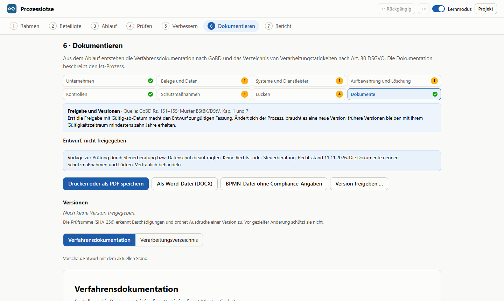

# Prozesslotse

Geschäftsprozesse über geführte Fragen modellieren, als BPMN-2.0-Diagramm zeichnen, mit Kennzahlen prüfen und mit begründeten Vorschlägen verbessern. Läuft als Windows-Programm oder im Browser, ohne KI und ohne Server.


## Was es kann

- **Geführter Assistent statt Zeichenwerkzeug.** Der Ablauf entsteht aus Antworten auf „Was passiert als Nächstes?“ und acht Bausteinen: Aufgabe, Entscheidung, Mehrere Wege (ODER), Mehrere Dinge unabhängig voneinander (gleichzeitig, bis eins fertig ist, oder eine Person in beliebiger Reihenfolge), Wiederholung, Warten, Etwas für jedes Stück einer Liste und Abschnitt mit Namen. Der Assistent führt nacheinander durch jeden Zweig einer Verzweigung und in jeden Abschnitt hinein; vorhandene Schritte lassen sich nachträglich zu einem Abschnitt zusammenfassen.
- **Rückfragen und Korrekturschleifen.** Jeder Ausgang einer Entscheidung führt weiter, beendet den Prozess oder springt zu einem früheren Schritt zurück. Endet der Prozess neben gleichzeitig laufenden Schritten (in einem Zweig von „Gleichzeitig“ oder „weiter beim ersten“, in einem ODER-Weg, bei Stücken zur selben Zeit), wird abgebrochen, was gleichzeitig läuft. Eine Entscheidung kann auch davon abhängen, was zuerst passiert (Antwort des Kunden, Stornierung, Ablauf einer Frist), in BPMN ein ereignisbasiertes Gateway.
- **Unterbrechungen:** Während einer Aufgabe, eines Abschnitts oder der ganzen Liste „für jedes Stück“ kann etwas dazwischenkommen, eine Nachricht (Kunde storniert) oder eine Frist. Entweder wird die Arbeit abgebrochen, und es geht hinter dem Schritt weiter, noch einmal von vorn, zurück, oder der Vorgang endet; oder ein Nebenweg läuft nebenher, auch mehrmals je Ausführung. Gilt eine Frist für mehrere Schritte, fasst der Assistent sie zu einem Abschnitt zusammen.
- **Korrekt durch Bauweise und Prüfung.** Jede Verzweigung wird automatisch wieder zusammengeführt, Rücksprünge werden zu sauberen Bereichen (blockstrukturiertes Modell). Was die Bauweise allein nicht verhindert, etwa ein Rücksprung aus „Gleichzeitig“ heraus, ein Ende in einem Nebenweg oder eine Entscheidung, deren Ausgänge alle zurückspringen, melden die Prüfregeln als Fehler. Dazu kommen Anteile ungleich 100 %, fehlende Angaben und Benennungen gegen die 7PMG-Richtlinien. Ein Tokenspiel nach den Ausführungsregeln von BPMN bestätigt in den Tests: Meldet die Prüfung keinen Fehler, ist das exportierte Diagramm sound.
- **Normgerechtes BPMN 2.0** mit einer Bahn je Rolle, Benutzer- und manuellen Aufgaben, Ereignissen und Diagramm-Informationen (DI). Abschnitte werden aufgeklappte Teilprozesse mit eigenem Start und Ende; endet der Vorgang darin, fängt ein Fehler-Randereignis am äußersten Abschnitt den Ausstieg. „Für jedes Stück einer Liste“ wird eine Mehrfachinstanz, der Reihe nach oder zur selben Zeit: an der Aufgabe, wenn es nur eine ist, sonst an einem Rahmen. Unterbrechungen werden Randereignisse (Zeit oder Nachricht, unterbrechend oder nebenher) mit eigenem Ausnahmeweg; „weiter“ führt über eine Zusammenführung hinter dem Schritt, ein Nebenweg endet für sich. Ein Ende neben gleichzeitig laufenden Schritten wird ein Terminierungs-Endereignis, in einem Abschnitt ein Fehler-Ende, hinter dessen Randereignis die Terminierung steht. „Weiter beim ersten“ wird ein Teilprozess, in dem jeder Zweig mit einer Terminierung endet; „in beliebiger Reihenfolge“ ein Ad-hoc-Teilprozess mit je einer Aktivität je Zweig, mehrschrittige Zweige als eingebettete Teilprozesse. Externe Beteiligte wie der Kunde werden eigene Pools mit Nachrichtenflüssen (Kollaboration). Die Datei öffnet sich in bpmn.io, Camunda Modeler oder Signavio.
- **Saubere Linienführung:** Jeder Fluss ist eine eigene Linie; zwei Flüsse teilen sich nie eine Strecke oder einen Anschlusspunkt, und wo zwei länger als 100 px nebeneinander laufen, liegen sie mindestens 20 px auseinander, damit man sie auch beim Einpassen und im Druck als zwei Linien erkennt. Gateways verteilen ihre Wege auf eigene Anschlüsse, Spaltenlücken werden zu Kanälen mit einer Spur je Linie, die Reihenfolge minimiert Kreuzungen. Kein Sequenzfluss quert die Grenze eines Teilprozesses; was sonst hindurch müsste, rückt hinter den Rahmen. Randereignisse sitzen auf der Unterkante ihres Schritts, ihre Abgänge schachteln sich ohne Kreuzung, Nachrichten kommen von unten links an den Kreis. Beschriftungen suchen sich einen freien Platz.
- **Kennzahlen mit nachvollziehbaren Formeln:** Durchlaufzeit, Flusseffizienz, Kosten je Vorgang, Auslastung je Rolle mit Engpass nach dem Warteschlangenmodell M/M/c (die Schwelle hängt von der Teamgröße ab), Vorgänge in Arbeit nach dem Gesetz von Little, Medienbrüche und Übergaben. Eine Monte-Carlo-Simulation liefert zusätzlich den 90-%-Wert der Durchlaufzeit und die Durchlaufzeit je Ergebnis (z. B. versendet, storniert, verfallen).
- **Schwachstellen im Diagramm:** Medienbruch, Engpass, lange Liegezeit, Nacharbeit, Freigabe ohne erkennbaren Nutzen, Kontrolle ohne Folge, dieselbe Person in parallelen Zweigen, zu wenig Leute für Stücke, die zur selben Zeit laufen, viel abgebrochene Arbeit (auch in gleichzeitig laufenden Zweigen, die oft umsonst arbeiten, weil ein Zweig den Vorgang beendet), oft überschrittene Fristen und Hin und Her zwischen Rollen werden am betroffenen Element markiert. Nur Korrekturen zählen als Nacharbeit. Mehrere gleiche Durchgänge („je Position“) bildet „für jedes Stück einer Liste“ ab; ältere Mengenschleifen, Ausgänge wie „beides“ und Rollen wie „Kunde“ bietet die Prüfung zum Umwandeln an, ohne still umzubauen.
- **Vorschläge mit berechneter Wirkung.** Sechs Regeln formen eine Kopie des Prozesses um, die Wirkung kommt aus denselben Formeln wie die Kennzahlen. Übernommene Vorschläge ergeben den Soll-Prozess.
- **Bericht** mit Ist-Soll-Vergleich, Maßnahmen, Befunden und beiden Diagrammen. Export als BPMN, SVG und Projektdatei, Druck als PDF.
- **Compliance-Doku:** Aus dem Ist-Prozess entstehen die Verfahrensdokumentation nach GoBD und das Verzeichnis von Verarbeitungstätigkeiten nach Art. 30 DSGVO, mit Lückenprüfung, freigegebenen Versionen und Export als Word-Datei und PDF ([Abschnitt unten](#compliance-doku)).
- **Windows-Programm (Tauri 2):** Installer mit 1,3 MB, pro Benutzer und ohne Admin-Rechte. Projekte sind `.prozesslotse`-Dateien; ein Doppelklick öffnet sie, auch im schon laufenden Programm. Speichern, Speichern unter, „Zuletzt geöffnet“, Rückfrage bei ungespeicherten Änderungen und PDF in A4 ohne Druckdialog, auch für Verfahrensdokumentation und Verzeichnis; deren Word-Dateien gehen über den Speichern-Dialog. Exportiertes BPMN enthält das ganze Projekt und öffnet sich wieder verlustfrei; fremde BPMN-Dateien werden angezeigt.
- **Lernmodus:** Zu jeder Auswahl erklärt ein Hinweis das passende BPMN-Element.

| Ablauf beschreiben | Verbessern |
| --- | --- |
|  |  |

## Fallbeispiel

Ein regionaler Lieferdienst, von der telefonischen Bestellung bis zur Rechnung, mit 120 Vorgängen am Tag und 6 Rollen. Das Werkzeug findet:

- 6,7 Arbeitstage Durchlaufzeit, davon nur 1,5 % Bearbeitung
- einen Engpass bei der Niederlassungsleitung (98 % Auslastung) durch eine Freigabe, die in 98 % der Fälle erteilt wird, und einen bei der Buchhaltung (81 %, eine Person)
- drei Medienbrüche, Nacharbeit beim Kommissionieren, zweimal Hin und Her zwischen Rollen

Zwei Vorschläge (Freigabe streichen, Tourenplanung parallel zur Kommissionierung) senken die Durchlaufzeit auf 4,5 Arbeitstage.

Ein zweites Beispiel, **Onlinebestellung**, zeigt eine Korrekturschleife: Sind die Bestelldaten fehlerhaft, wird der Kunde gefragt. Kommt seine Korrektur, geht es zurück zur Erfassung; storniert er oder läuft die Frist von 7 Tagen ab, endet der Vorgang.

## Formeln

| Kennzahl | Berechnung |
| --- | --- |
| Häufigkeit eines Schritts | Produkt der Anteile auf dem Weg dorthin; eine Wiederholung, die in r der Durchläufe wiederholt, läuft 1 / (1 − r)-mal; ein Abschnitt rechnet wie die Folge seiner Schritte, „in beliebiger Reihenfolge“ wie die Folge der Zweige in der Reihenfolge der Liste; bei „weiter beim ersten“ zählen alle Zweige voll, ebenso bei Gleichzeitig, gewählten ODER-Wegen und Stücken zur selben Zeit, auch wenn ein anderer Teil den Vorgang vorher beendet; für jedes Stück (N Stücke, jedes endet mit c normal): der Reihe nach E[(1 − c^N) / (1 − c)]-mal, zur selben Zeit E[N]-mal, danach geht es mit E[c^N] weiter; Unterbrechung j mit festem Anteil q_j je Ausführung: Der Schritt zählt voll, sein Ausnahmeweg läuft q_j-mal, ein Nebenweg c-mal je Ausführung; normal weiter geht es mit 1 − Σq_j |
| Durchlaufzeit | hintereinander addiert, Entscheidung gewichtet gemittelt, Gleichzeitig: Erwartungswert des Maximums der Zweigdauern (aus deren Verteilungen); beendet ein Zweig, ein gewählter ODER-Weg oder ein Stück zur selben Zeit den Vorgang, gilt der früheste Abbruch: Abbruch-Teil 1 − Π(1 − Gᵢ(t)), Weiter-Teil Π Hᵢ(t) ohne Normierung (Gᵢ, Hᵢ: Teil i bis t abgebrochen bzw. normal fertig; bei ODER über die Ziehung der Wege), bei Gleichstand gewinnt der frühere Zweig; weiter beim ersten: Erwartungswert des Minimums (bei Gleichstand gewinnt der frühere Zweig), in beliebiger Reihenfolge: Summe der Zweige, Wiederholung: Körper × 1 / (1 − r), für jedes Stück: Liegezeit einmal, dazu der Reihe nach die Summe der Stücke, zur selben Zeit das späteste (F(t) = E[F_Stück(t)^N]); unterbrochener Schritt: Zeit bis zur Unterbrechung (Frist; Nachricht vorher L/2, während der Arbeit L + B/2, unbekannt (L + B)/2; an einem Abschnitt die halbe Dauer des Durchlaufs), danach der Ausnahmeweg; Nebenwege verlängern nichts |
| Flusseffizienz | theoretische Durchlaufzeit (gleiche Rechnung, nur Bearbeitungszeiten) / Durchlaufzeit |
| Kosten je Vorgang | Σ Häufigkeit × Bearbeitungszeit × Stundensatz der Rolle |
| Auslastung | Vorgänge pro Tag × Arbeitszeit der Rolle je Vorgang / (Personen × Arbeitsstunden × verfügbarer Anteil) |
| Engpass | mittlere Wartezeit nach M/M/c (Erlang C) mindestens viermal so lang wie die Bearbeitung: bei einer Person ab 80 % Auslastung, bei zwei ab 89 %, bei sechs ab etwa 95 % |
| Vorgänge in Arbeit | Vorgänge pro Tag × Durchlaufzeit in Arbeitstagen (Gesetz von Little); bei Überlast nicht angegeben, weil der Bestand dann wächst |
| Medienbrüche, Übergaben | erwartete Anzahl manueller Übertragungen bzw. Rollenwechsel zwischen aufeinanderfolgenden Aufgaben; hinter Gleichzeitig und ODER zählt die letzte Aufgabe jedes Zweigs, wenn alle normal enden, und der Vorgänger, wenn dazu mindestens ein gewählter Weg ohne Aufgabe bleibt |

Wiederholungen werden geschlossen gelöst, nicht ausgerollt. Ein Ausgang, der den Prozess vorzeitig beendet, geht mit seiner Wahrscheinlichkeit in alle Werte ein; neben gleichzeitig laufenden Schritten mit der Wahrscheinlichkeit, dass er der erste Abbruch ist.

## Verbesserungsregeln

| Regel | Erkennt | Umformung |
| --- | --- | --- |
| Gleichzeitig ausführen | Schritt braucht das Ergebnis des vorherigen nicht, andere Rolle | beide Schritte in „Gleichzeitig“ |
| Medienbruch beseitigen | Daten werden von Hand übertragen | Übertragung und ihre Minuten entfallen |
| Zusammenlegen | zwei Schritte derselben Rolle mit Liegezeit dazwischen | ein Schritt, Liegezeit und Abtippen entfallen |
| Nacharbeit senken | Korrektur-Wiederholung in mindestens 15 % der Durchläufe | Anteil halbiert (als Annahme gekennzeichnet) |
| Kontrolle reduzieren | Freigabe wird in mindestens 90 % der Fälle erteilt | Freigabe entfällt, eine direkt folgende Entscheidung darüber mit (als Annahme gekennzeichnet) |
| Knock-out-Reihenfolge | mehrere Prüfungen hintereinander, die jeweils Fälle aussortieren | aufsteigend nach Dauer / Ausfallquote sortiert, so dass die schnelle, oft aussortierende Prüfung zuerst kommt (Unabhängigkeit als Annahme) |

Prüfungen und Freigaben werden nie mit anderen Schritten zusammengelegt (Vier-Augen-Prinzip).

## Compliance-Doku



Der Schritt „Dokumentieren“ erzeugt aus dem Ist-Prozess zwei Dokumente, die in kleinen Betrieben oft fehlen:

- die **Verfahrensdokumentation** nach GoBD Rz. 151–155 in der Gliederung der Muster-Verfahrensdokumentation von BStBK und DStV (Version 2.1). Kapitel 4 beschreibt den modellierten Ablauf Schritt für Schritt: Bedingungen, Zuständigkeit, System, Unterlagen, Medienbrüche, Kontrollen und Nachrichten an Externe, dazu Abschnitte, „für jedes Stück“, Unterbrechungen mit ihren Ausnahmewegen und Abbrüche;
- das **Verzeichnis von Verarbeitungstätigkeiten** nach Art. 30 Abs. 1 DSGVO im Aufbau des Musters der Datenschutzkonferenz, mit den technischen und organisatorischen Maßnahmen in sechs Bereichen.

| Teilschritt | Fragt nach |
| --- | --- |
| Unternehmen | Verantwortlicher, Geschäftsleitung, Datenschutzbeauftragter (§ 38 BDSG), Rollen im Ablauf (intern oder extern mit Organisation), Verarbeitungstätigkeit; Übernahme aus einer anderen Projektdatei |
| Belege und Daten | je Unterlage: Einordnung nach § 147 AO, Form, Ablage, ersetzendes Scannen, Personenbezug, Rechtsgrundlage samt Ausnahme nach Art. 9 Abs. 2 DSGVO, Empfänger; Zweck der Verarbeitung |
| Systeme und Dienstleister | Version, Betrieb, Standort (im Drittland mit Bewilligung des Finanzamts), Vertrag zur Auftragsverarbeitung, Schutz vor Änderung, Wiederfinden und Datenzugriff bei einer Außenprüfung, Datensicherung, Zugriffsschutz |
| Aufbewahrung und Löschung | gesetzliche und gewählte Frist, frühestes Löschdatum, Löschfristen, wer löscht |
| Kontrollen | Prüfungen und Freigaben mit Vier-Augen-Status, weitere Kontrollen, Einweisung |
| Schutzmaßnahmen | sechs Bereiche nach Art. 32 Abs. 1 DSGVO mit Vorschlägen |
| Lücken | 44 Regeln mit Quelle und „Beheben“ (springt auf die offene Frage), z. B. Frist kürzer als vorgeschrieben, E-Mail-Postfach als einziges Archiv, Freigabe ohne Vier-Augen-Prinzip, Vertrag zur Auftragsverarbeitung fehlt, Aufbewahrung im Drittland ohne Bewilligung |
| Dokumente | Vorschau, Druck als PDF (im Programm auch ohne Druckdialog), Word-Datei, Freigabe mit optionaler fachlicher Prüfung, Versionsliste mit nachgerechneter Prüfsumme, Zurückziehen einer Freigabe, die noch nicht gilt, mitgeltende Unterlagen |

- **Fristen** nach § 147 AO: Bücher und Organisationsunterlagen 10 Jahre, Buchungsbelege 8, Geschäftsbriefe und sonstige Unterlagen 6, jeweils ab Ende des Kalenderjahres; Lieferscheine ohne Buchungsfunktion bis zur Rechnung, bei Kaufleuten mit dem Hinweis auf 6 Jahre als möglicher Handelsbrief (§ 257 HGB).
- **Versionen:** Eine Freigabe friert Ist-Prozess und beide Dokumente ein, mit Gültig-ab-Datum, Freigabe, Inhalt der Änderung, geänderten Kapiteln und SHA-256-Prüfsumme über kanonisches JSON von Prozess und Dokumenten. Nach dem Laden rechnet die App jede Prüfsumme nach und zeigt deutlich, wenn eine Version verändert wurde. Nur Entwürfe tragen den Hinweis „Vorlage – vor Verwendung prüfen lassen“; eine freigegebene Fassung nennt in der Fußzeile Version und Freigabetag, auf dem Deckblatt die Verantwortung des Unternehmens und auf Wunsch „Fachlich geprüft von … am …“. Ändert sich danach etwas Fachliches, nennt die Lückenprüfung die betroffenen Kapitel; nach 365 Tagen erinnert sie an die Überprüfung. Eine Freigabe, deren „Gültig ab“ noch in der Zukunft liegt, lässt sich mit Begründung zurückziehen; sie bleibt sichtbar.
- **Speichergrenzen:** Jede Version enthält die ganze Änderungshistorie. Beim Beispiel (eine Freigabe im Monat) ist der Browser-Speicher bei rund 105 Versionen voll; dann meldet die App das, und nur die Projektdatei sichert weiter. Die Projektdatei erreicht die 20-MiB-Grenze des Windows-Programms bei rund 185 Versionen. Nichts geht dabei still verloren: Ein Stand, der nicht vollständig in den Browser-Speicher passt, öffnet beim nächsten Start als neues, ungespeichertes Dokument.
- **Vertraulich behandeln:** Die Angaben beschreiben Schwachstellen wie eine fehlende Datensicherung. Projektdatei und Ausgaben gehören nicht an Dritte; die BPMN-Datei lässt sich ohne Compliance-Angaben exportieren, und „Daten im Browser löschen“ leert den Browser-Speicher.
- **Keine Rechts- oder Steuerberatung:** Beide Dokumente sind Vorlagen zur Prüfung durch Steuerberatung bzw. Datenschutzbeauftragten, keine Rechts- oder Steuerberatung. Die App prüft, ob die Angaben vollständig und widerspruchsfrei sind, nicht, ob sie stimmen.

Spezifikation, Annahmen und Stand: [compliance-spezifikation.md](docs/compliance-spezifikation.md), [compliance-entscheidungen.md](docs/compliance-entscheidungen.md), [compliance-stand.md](docs/compliance-stand.md).

## Aufbau

| Ordner | Inhalt |
| --- | --- |
| `src/modell` | Datenmodell, Operationen, Prüfregeln, Führung durch den Ablauf, Speichern, Fallbeispiel |
| `src/analyse` | Kennzahlen, Simulation, Schwachstellen, Verbesserungsregeln |
| `src/compliance` | Compliance-Doku: Angaben, Fristen, Lückenprüfung, Verfahrensdokumentation, Verzeichnis, Versionen, DOCX |
| `src/bpmn` | eigenes Layout mit Bahnen und Spuren, Linienführung mit Kanälen, BPMN-XML mit DI, Tokenspiel |
| `src/ui` | React-Oberfläche: Assistent, Diagramm (bpmn-js), Prüfen, Verbessern, Bericht |
| `src/plattform` | Öffnen, Speichern und Fenster: im Browser per Download, im Programm über den Rust-Teil |
| `src-tauri` | Windows-Programm: Dateibefehle nur für vom Benutzer gewählte Pfade (Word-Dateien als Rohdaten, ohne Base64), Menü, PDF über WebView2, Installer |
| `e2e` | Browsertests mit Playwright und axe |
| `docs` | [Datenmodell](docs/datenmodell.md) mit Zeichenregeln, [Fragenkatalog](docs/fragenkatalog.md), [Modellierung, Format 3](docs/modellierung-v3.md), [Modellierung, Format 4](docs/modellierung-v4.md) mit [Stand](docs/modellierung-stand.md), [Compliance-Doku](docs/compliance-spezifikation.md) |

Die Fachlogik kennt kein React und ist vollständig getestet. bpmn-js dient nur der Anzeige; Layout und BPMN-Export sind selbst geschrieben.

**Technik:** React 19, TypeScript 7, Vite 8, bpmn-js 18, Tauri 2 (Rust), Vitest, Playwright, GitHub Actions.

## Qualität

- 692 Unit-Tests (434 davon zur Compliance-Doku) und 6 Rust-Tests, darunter von Hand nachgerechnete Kennzahlen und ein Belastungstest mit 300 zufällig erzeugten, verschachtelten Prozessen (mit Rücksprüngen, Ereignis-Entscheidungen, ODER-Verzweigungen, Abschnitten, Mehrfachinstanzen, Unterbrechungen, „weiter beim ersten“, „in beliebiger Reihenfolge“, Abbrüchen neben gleichzeitig laufenden Schritten und Nachrichten): keine Überlappung, keine Kante durch fremde Elemente, keine zwei Linien auf derselben Strecke oder am selben Anschluss, keine zwei Linien länger als 100 px dichter als 20 px nebeneinander, kein Sequenzfluss über eine Rahmengrenze, Randereignisse auf dem Rand ihres Schritts, Beschriftungen frei, Schema-Prüfung mit bpmn-moddle.
- Tokenspiel nach den Ausführungsregeln von BPMN 2.0, mit Teilprozessen als Bereichen, Fehler-Enden, Terminierungen, Ad-hoc-Teilprozessen, Randereignissen (unterbrechend und nebenher) und der Regel der Norm für die inklusive Zusammenführung: Für beide Beispiele und alle 300 Zufallsprozesse ist das exportierte Diagramm sound (keine Verklemmung, jeder Vorgang kann enden, kein toter Schritt), der aus dem XML gelesene Graph gleicht dem des Layouts, und die Häufigkeiten und Ergebnisanteile aus dem Tokenspiel stimmen mit den Formeln überein. Stehen mehrere Abbrüche an, entscheidet in der Zählung eine Uhr je Marke, welcher zuerst kommt.
- 111 Browsertests, davon 26 zum Prozess: Prozess vollständig über den Assistenten anlegen, Korrekturschleife mit Rücksprung, ODER-Verzweigung, Abschnitt mit Ende darin, Schritte zu einem Abschnitt zusammenfassen und auflösen, „für jede Position“ anlegen, Mengenschleife aus einer älteren Datei umwandeln, Unterbrechung mit Ende und Nebenweg anlegen, Frist über mehrere Schritte mit „noch einmal von vorn“, „weiter beim ersten“ und „in beliebiger Reihenfolge“ mit Ende in einem Zweig anlegen, Prozessende in einem Zweig von „Gleichzeitig“, Kunde als Pool mit Nachrichten, Tastaturbedienung, Vorschlag übernehmen, Exporte, Datei öffnen, BPMN wieder öffnen, Rückfrage bei ungespeicherten Änderungen.
- Desktop-Test am echten Programm (`npm run desktop:test`): 48 Prüfungen in drei Programmstarts, von Speichern unter bis zur Rückfrage beim Schließen, PDF-Seite in A4; dazu die Compliance-Doku mit Freigabe, Word-Datei als Rohdaten (falsche Aufrufe werden abgelehnt), PDF der Verfahrensdokumentation, Nachladen des Schritts „Dokumentieren“ und Wiederöffnen nach Neustart; sicherer Kontext, Web Crypto und keine Meldung der Content Security Policy.
- Installer-Test in der CI auf Windows: still installieren, Dateizuordnungen prüfen (`.bpmn` nur unter „Öffnen mit“), still deinstallieren.
- Barrierefreiheit: axe meldet in keinem Schritt schwere Befunde, weder hell noch dunkel; jedes Eingabefeld ist beschriftet.
- Bei jedem Push laufen Lint, Unit-Tests, Build und Browsertests.
- Compliance-Doku: 44 Regeln mit Positiv- und Negativfall, von Hand nachgerechnete Fristen (Monatsende, Schaltjahr, 365 und 366 Tage), die Testdaten liefern genau die erwarteten 7 Befunde; 300 Zufallsprozesse erzeugen Dokumente ohne Absturz und ohne Konformitätsversprechen; Kapitel 4 beschreibt jeden Baustein aus Format 4 (Abschnitt, für jedes Stück, Unterbrechungen, „weiter beim ersten“, „in beliebiger Reihenfolge“, Ende neben gleichzeitig laufenden Schritten); eine echte Format-3-Datei mit Freigabe lädt mit stimmender Prüfsumme und ohne geänderte Kapitel; DOCX wird entpackt und geprüft; Speichern mit vollem oder beschädigtem Browser-Speicher, zwei Tabs und Prüfsummen. 85 Browsertests decken Lücken und „Beheben“, Freigabe und Rückzug, Speichern und Laden von Versionen, Word-Datei, Druck (alle Tabellen passen auf A4, neue Seiten nur vor großen Kapiteln, Anlage 9.1 in lesbaren Ausschnitten, jede Form in einem Ausschnitt ganz, auch mit Abschnitten und Randereignissen, Bahnnamen am Rand), Meldungen am Feld, Fokus und Sprünge, schmale Fenster, Tastatur und axe hell und dunkel ab. Die 82 Funde einer unabhängigen Durchsicht und die Mängel der Nachprüfung sind behoben, jeder mit einem Test ([Stand](docs/compliance-stand.md#durchsicht-vom-11112026)).

## Entwickeln

```bash
npm install
npm run dev       # Entwicklungsserver
npm test          # Unit-Tests (Vitest)
npm run e2e       # Browsertests (lokal mit Edge, in der CI mit Chrome)
npm run build     # Typprüfung und Produktions-Build

# Windows-Programm (braucht Rust und die VS Build Tools)
npm run desktop                        # Programm mit Entwicklungsserver
npm run desktop:build                  # Programm und Installer (src-tauri/target/release/bundle/nsis)
npx tauri build --debug --no-bundle    # Debug-Build für den Desktop-Test
npm run desktop:test                   # Desktop-Test gegen den Debug-Build (andere exe: PROZESSLOTSE_EXE)
```

`node scripts/readme-bilder.mjs` erzeugt die Bilder dieser README neu (bei laufendem `npx vite preview --port 4173`).

## Grenzen

- Zeiten und Anteile sind Schätzungen; alle Werte sind Erwartungswerte.
- Die Simulation würfelt die Wege (Entscheidungen, Wiederholungen), nicht die Zeiten je Schritt. Der 90-%-Wert ist deshalb eher zu niedrig.
- Wartezeiten durch Auslastung gehen nicht in die Durchlaufzeit ein; dafür stehen die geschätzten Liegezeiten. Das Warteschlangenmodell bewertet nur, ab wann eine Rolle zum Engpass wird. Es nimmt zufällig eintreffende Arbeit an und ist für geplante, gebündelte Arbeit eher zu vorsichtig.
- Bei „Gleichzeitig“ gelten die Zweige als unabhängig. Arbeitet dieselbe Person in mehreren Zweigen, ist die berechnete Dauer zu niedrig; ein Hinweis meldet das.
- Rücksprünge führen nur zu früheren Schritten derselben oder einer umgebenden Ebene, nie aus „Gleichzeitig“ heraus und nie aus einem Rahmen (Abschnitt, „für jedes Stück“, Zweig von „weiter beim ersten“ oder „in beliebiger Reihenfolge“).
- Rahmen (Abschnitte, „für jedes Stück“, „weiter beim ersten“, „in beliebiger Reihenfolge“) liegen mit allen Schritten in einer Bahn; Schritte anderer Rollen tragen im Diagramm die Rolle in Klammern. Teilprozesse sind immer aufgeklappt; zugeklappte mit eigener Ansicht gibt es nicht.
- „Weiter beim ersten“ bricht die übrigen Zweige ab; dass sie trotzdem zu Ende laufen, lässt sich nicht abbilden. Ihre Arbeit zählt voll (obere Schranke). Weil die Rechnung nur Durchschnittszeiten kennt, zeigt sie bei gleich langen Zweigen keinen Zeitgewinn; ein Hinweis erklärt das.
- „In beliebiger Reihenfolge“ rechnet in der Reihenfolge der Liste. Kann ein Zweig den Vorgang beenden, hängt davon ab, wie oft die Zweige dahinter laufen; ein Hinweis weist darauf hin.
- „Für jedes Stück einer Liste“: Die Zahl der Stücke ist entweder fest (immer etwa gleich viele, die kleinste Streuung um den Schnitt) oder schwankt geometrisch wie die Durchläufe einer Wiederholung. Zur selben Zeit heißt: so viele Leute wie Stücke; hat eine Rolle weniger, meldet ein Hinweis, dass die Dauer zu niedrig ist. Gerechnet wird mit höchstens 10.000 Stücken je Vorgang.
- Unterbrechungen haben feste Anteile je Ausführung des Schritts, unabhängig vom Weg darin; mehrere an einem Schritt schließen sich aus. Eine Frist gilt ab Eingang beim Schritt, überschrittene Fälle dauern genau die Frist. Eine Nachricht an einem Abschnitt unterbricht nach der halben Dauer des Durchlaufs. Arbeit, die eine Unterbrechung abschneidet, zählt voll (obere Schranke).
- Nebenwege (nicht unterbrechende Ereignisse) verlängern die Durchlaufzeit nicht, auch nicht die eines Abschnitts, in dem ihr Schritt liegt; dauern sie länger als ihr Schritt, weist ein Hinweis darauf hin.
- Ein Prozessende neben gleichzeitig laufenden Schritten bricht alles ab. Was die übrigen Zweige, Wege oder Stücke bis dahin tun, zählt voll (obere Schranke). Welches Ergebnis gilt, wenn mehrere den Vorgang beenden können, folgt aus den Durchschnittszeiten: der früheste Abbruch, bei Gleichstand der frühere Zweig. Ein Ende, das nur den eigenen Zweig beendet, gibt es nur als Nebenweg.
- Endet ein ODER-Weg den Vorgang, rechnet der Prozesslotse die Schritte hinter der Zusammenführung nicht mehr. Nach BPMN darf die Zusammenführung schon schalten, sobald der beendende Weg sie nicht mehr erreichen kann; bis zur Terminierung könnten dahinter also noch Schritte anlaufen.
- Externe Beteiligte sind leere Pools (Black Box); ihr innerer Ablauf wird nicht modelliert.
- Auf eine Raute passen je Richtung höchstens etwa sechs Wege mit 20 px Abstand. Führen mehr Wege einer Verzweigung in dieselbe Richtung (etwa acht Fälle in derselben Bahn), liegen ihre Linien an der Raute dichter; sie teilen sich aber nie eine Strecke.
- Compliance-Doku: je Projekt ein Prozess; eine Gesamtdokumentation aller Systeme eines Betriebs (GoBD Rz. 151) entsteht erst mit einer Firmenmappe. Die Ablaufhemmung (§ 147 Abs. 3 AO) wird nicht berechnet, nur genannt. Ersetzendes Scannen, Kassenführung und Lohn sind nicht abgedeckt. Rechtsstand 11.11.2026; keine Gewähr für Vollständigkeit.

## Lizenz

Noch nicht festgelegt. bpmn-js steht unter der bpmn.io-Lizenz, die das bpmn.io-Logo im angezeigten Diagramm vorschreibt. Die Word-Datei erzeugt `docx` (MIT) mit `fflate` und `nanoid` (beide MIT).
